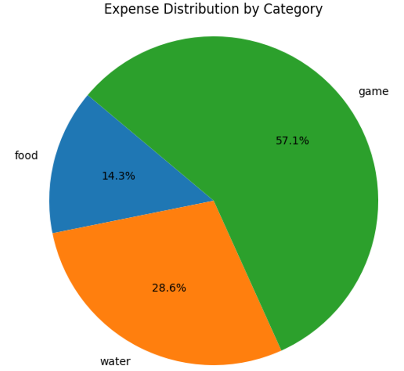

# Expense Tracker
這是一個使用 Python 開發的命令列記帳工具，支援支出紀錄的分類儲存，並能自動產生各分類的支出比例圓餅圖

## 組員分工
- **Member A**：負責實作輸入與 JSON 資料儲存模組 (`input_module.py`)
- **Member B**：負責實作資料讀取與分類圓餅圖視覺化模組 (`viz_module.py`)

## 環境與套件安裝
1. 確認 Python 環境：請確保電腦已安裝 Python 3.7 或以上版本
2. 從 GitHub 複製專案到本地端：
   git clone < GitHub專案網址 >
   cd < 專案資料夾 >
3. 安裝相依套件：視覺化模組需要使用 matplotlib 繪製圖表

## 執行方式
1. 執行主程式(main.py)
2. 依照終端機提示輸入數字選擇功能：
    輸入 1：新增一筆支出紀錄（依序輸入日期、金額、分類與備註）

    輸入 2：讀取目前紀錄並產生分類圓餅圖
    
    輸入 3：離開程式

## 圓餅圖範例

## 專案結構
├── main.py                  # 主程式整合進入點

├── input_module.py          # Member A：支出輸入與資料儲存模組

├── viz_module.py            # Member B：資料讀取與圓餅圖視覺化模組

├── expenses.json            # 儲存支出紀錄的 JSON 檔案（執行後自動生成）

├── expense_pie_chart.png    # 產生的圓餅圖截圖

└── README.md                # 專案說明文件